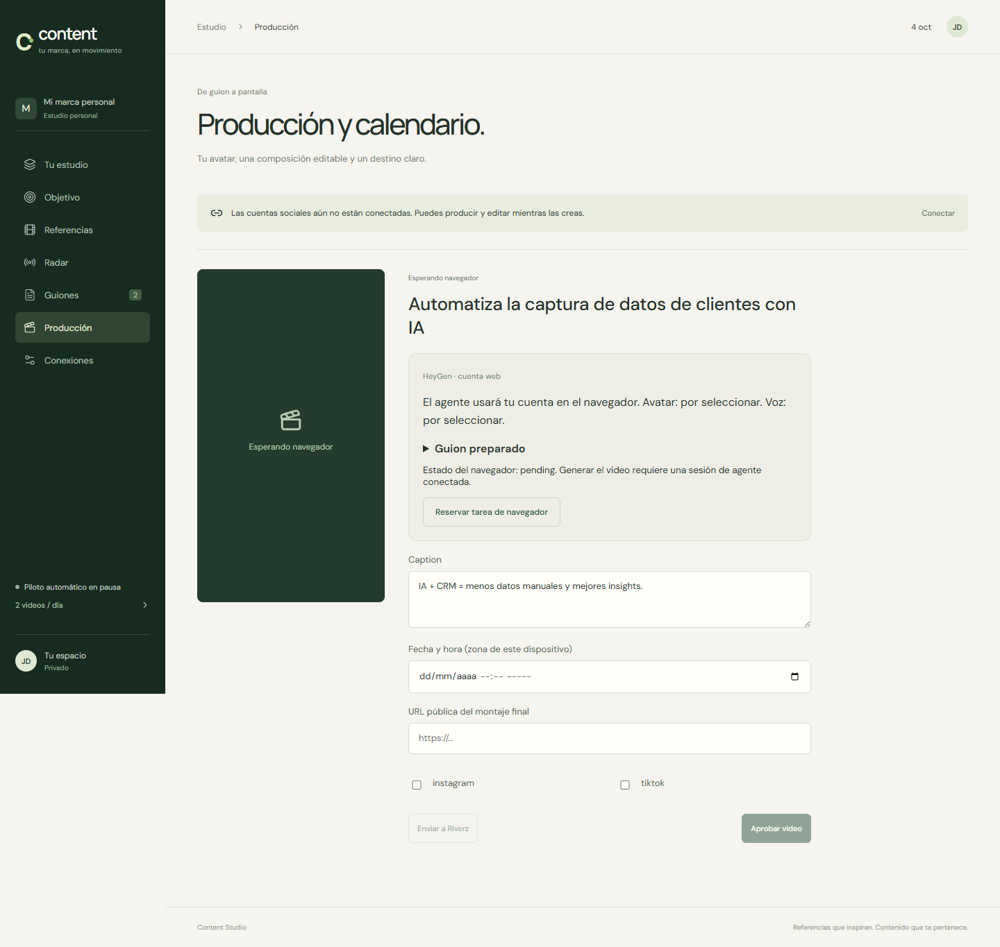

# AI workflows, knowledge and security

This is part of my development work as well as my product work. Internal tools, research systems and workflow libraries are identified by their actual role.

## Content Studio

**Work:** An internal content-production application linking reference research, transcription, original script writing, editorial review, avatar-production handoffs and editing/export in Riverz.

**My contribution:** The workflow and local pilot, source-backed script packages, approval states, production handoffs and integration with the surrounding tools.

**Stack and status:** TypeScript/Node.js, external research/media services and Riverz. The repository records local implementation, editorial material and pilot exports. These do not establish a fully unattended daily production pipeline or completed social publishing. Third-party reference material and personal production assets are not published here.

### Content Studio production handoff

Archived local application QA, October 4, 2026; Spanish/light interface. The visible item is waiting for a browser session; no completed video or social publication is claimed.

[Capture provenance](../SCREENSHOTS.md)

## Cerebro MEGA

**Work:** An internal ingestion pipeline that inventories media/documents, processes them with Gemini and builds an indexed knowledge collection.

**My contribution:** Resumable per-file processing, append-only checkpoints, retry handling, a watchdog, temporary staging and a generated master index.

**Stack and status:** JavaScript/Node.js, PowerShell and Gemini integration. The engineering work is the processing/recovery system. The underlying learning material, source files, transcripts and account access remain private; they are not presented as content I authored.

## Business research and presentation system

**Work:** An internal business knowledge base for a software/AI services offering, with audience research, market notes, positioning, a call deck and a self-read dossier.

**My contribution:** Structuring research and evidence, distinguishing sourced claims from estimates, and creating browser-based presentations plus a Python-generated PowerPoint deck.

**Stack and status:** Markdown, HTML/CSS, Python and presentation-generation tools. This is research and communication work with supporting automation, not an additional software-as-a-service product. Private research, pricing and presentation content are excluded.

## Reusable AI workflows

**Work:** A library of reusable instructions and supporting resources for AI-assisted application building, software delivery, UI research, creative preparation, advertising and media production.

**My contribution:** Defining workflow contracts, review criteria, reference material and supporting scripts so the same process can be reused across tasks and assistants.

**Stack and status:** Markdown-based skills with Python/JavaScript tooling and media/reference resources. This is a workflow/tooling library, not model training or a set of separately launched applications. Proprietary instructions and third-party reference assets remain private.

## Neo

**Work:** A local toolkit for authorized security work, combining specialist assistant definitions, a reference library and integrations with existing security tools.

**My contribution:** Organizing reconnaissance, web/security analysis and reporting roles; connecting the workflow to MCP/container backends; and maintaining scope/authorization guidance.

**Stack and status:** Assistant definitions, Python, Docker and MCP integrations. The reference work by afsh4ck and backends such as kali-mcp, HexStrike and VulnForce retain their original authorship and licenses. This represents integration/orchestration work, not original authorship of those scanners or proof of a completed client penetration test.

[Full portfolio](../README.md)
