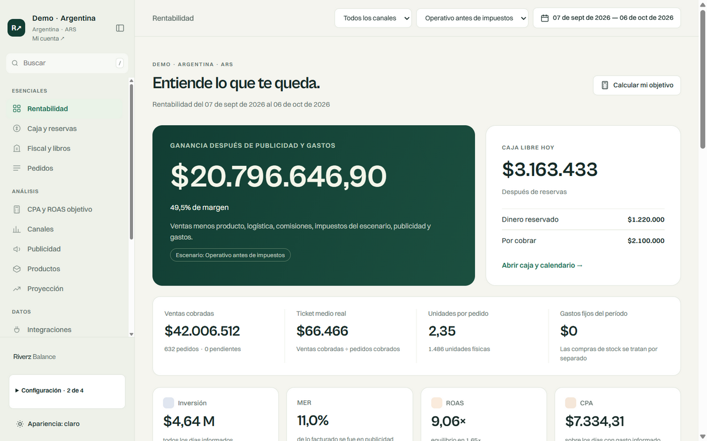
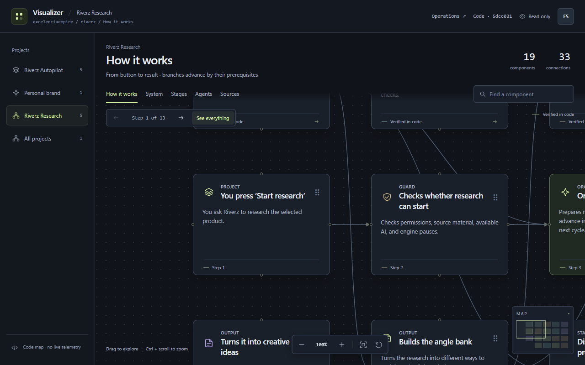
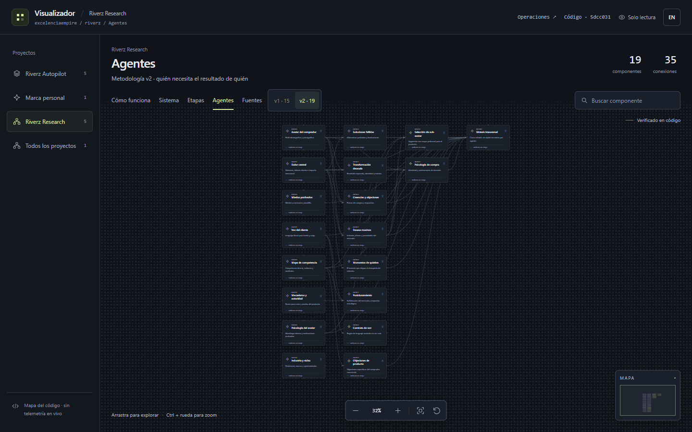
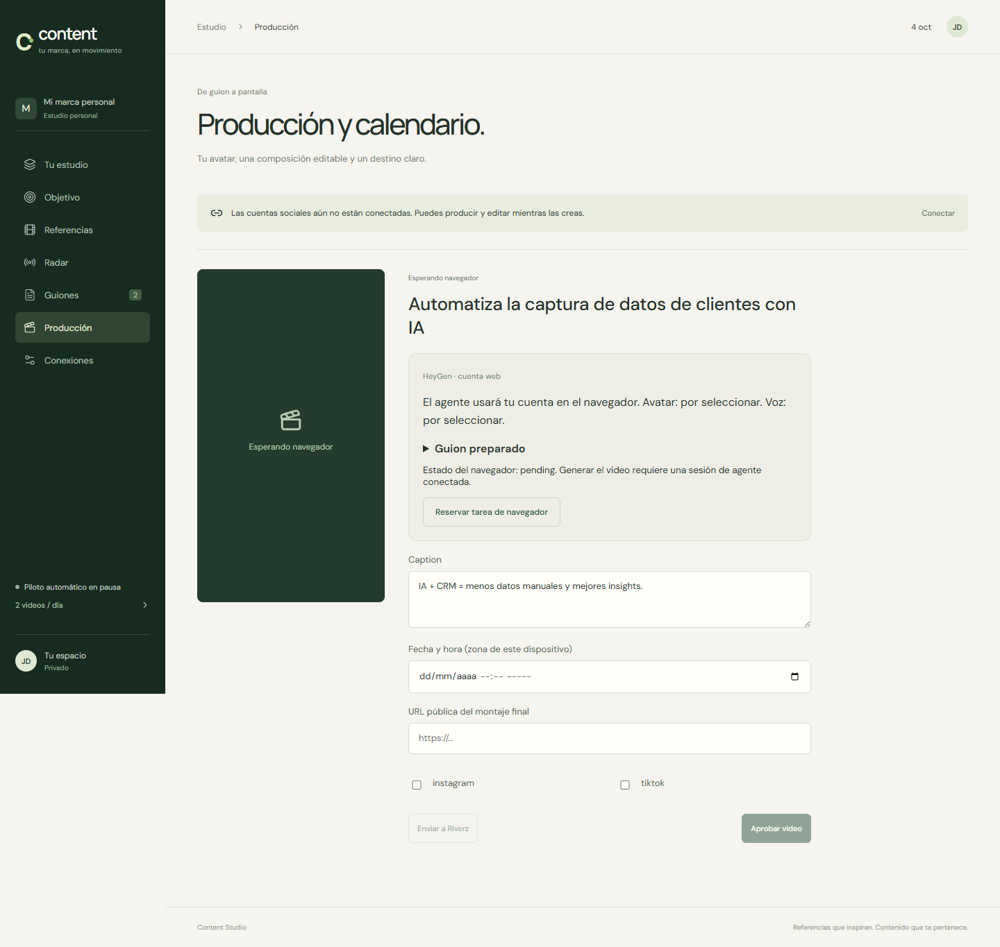
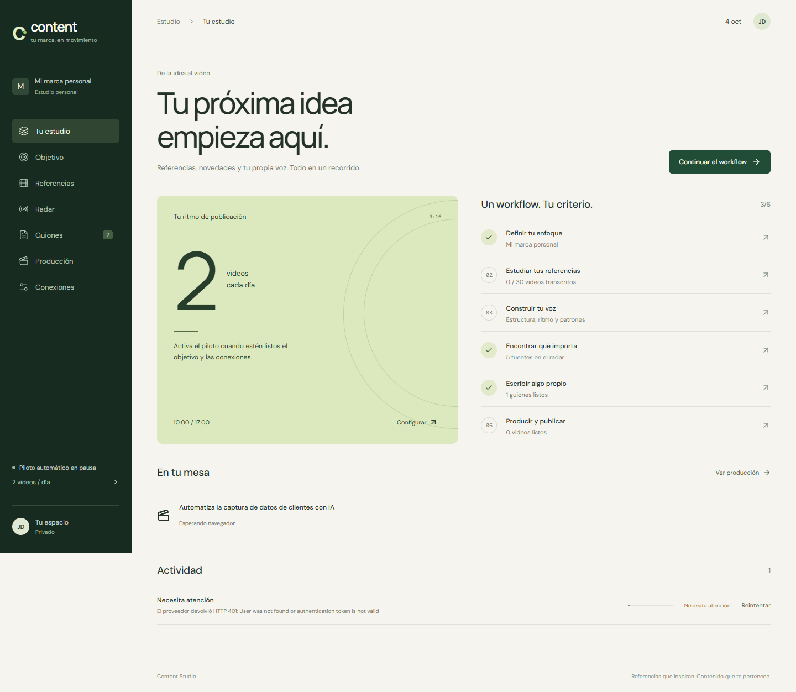
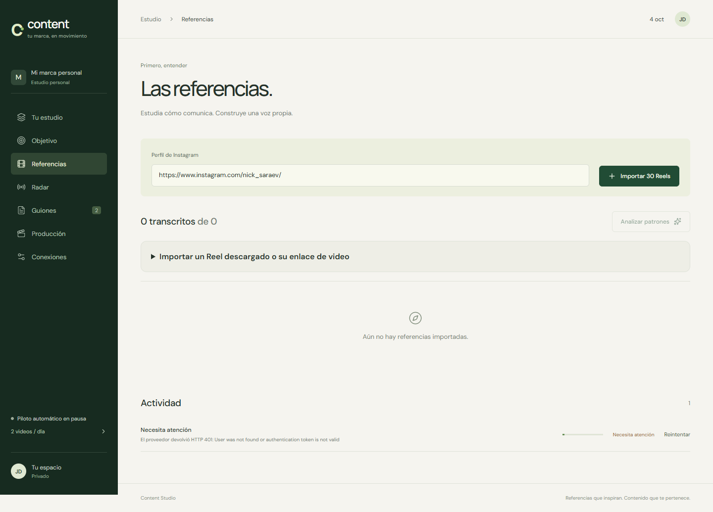
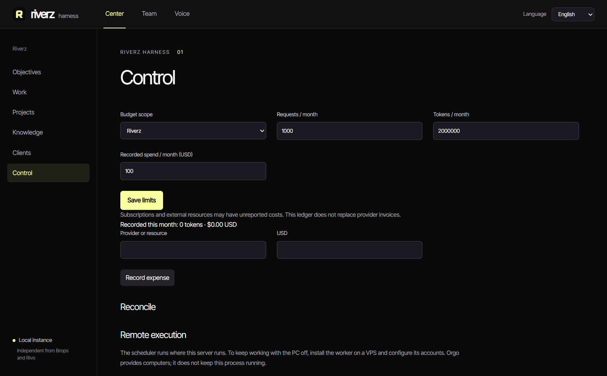
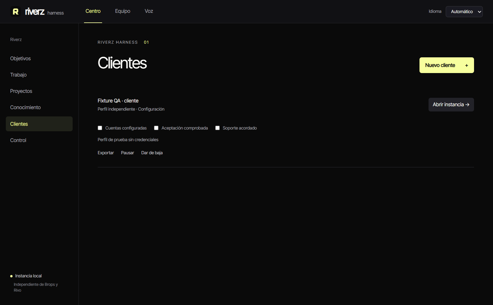
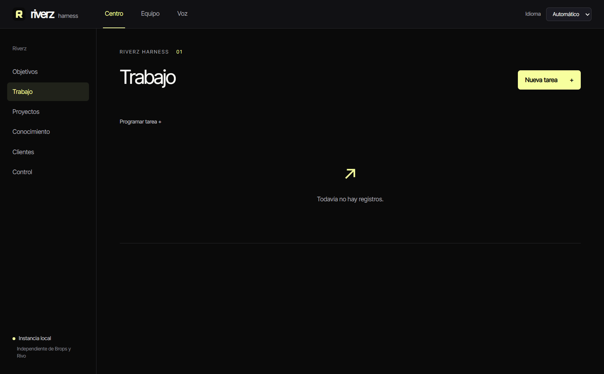

# Additional application tours

These are supporting applications and workspaces in the [work catalog](README.md). Main products have their own tours: [Riverz AI](https://github.com/excelenciaempire/riverz-showcase/blob/main/FEATURES.md), [Riverz CRM](https://github.com/excelenciaempire/riverz-crm-showcase/blob/main/FEATURES.md), [Radar](https://github.com/excelenciaempire/radar-showcase/blob/main/FEATURES.md), [Rivo](https://github.com/excelenciaempire/rivo-releases/blob/main/FEATURES.md) and [Spediak](https://github.com/excelenciaempire/spediak-showcase/blob/main/FEATURES.md).

The images below are original archived application captures. Native QA state and demonstration data are identified per image.

## Riverz Balance

### Profitability review

Read the accounting application's profitability view using its demo business.

*October 6, 2026; native Spanish/light, Demo Argentina figures.*

## Visualizador

### Architecture canvas

Navigate an application architecture map with pan/zoom and source references.

*October 7, 2026 implemented application; English/dark, read-only architecture view.*

### Workflow and agent map

Inspect a connected workflow map within the same visualization application.

*October 7, 2026 local application QA; Spanish/dark. The graph is an architecture map, not a running agent session.*

## Content Studio

### Production handoff

Inspect a content-production handoff and its waiting state.

*October 4, 2026 local application QA; Spanish/light. No completed video or social publication is implied.*

### Editorial workspace

Review the current content objective and the next editorial actions.

*October 4, 2026 local application QA; Spanish/light with pilot workspace state.*

### Reference intake

Add a public reference URL or select a downloaded video for the research workflow.

*October 4, 2026 local application QA; Spanish/light with no imported reference in the view.*

## Riverz Harness

### Harness controls

Inspect the combined desktop application's controls and isolated settings.

*October 8, 2026 local QA; English/dark with a test profile.*

### Client workspaces

Keep client-specific context, assistant routing and a repository reference together.

*October 8, 2026 local QA; Spanish/dark with an explicitly named fixture client.*

### Task center

Inspect the task-center entry point inside the desktop operations workspace.

*October 8, 2026 local QA; Spanish/dark, empty task list.*

## Other catalog work

Client websites, ingestion pipelines, workflow libraries, security integrations and tools without a selected public UI capture remain documented in their existing catalog pages. A design-handoff image or a private operational screen is not substituted for a missing application capture.

[Work catalog](README.md) · [Capture provenance](../SCREENSHOTS.md)
