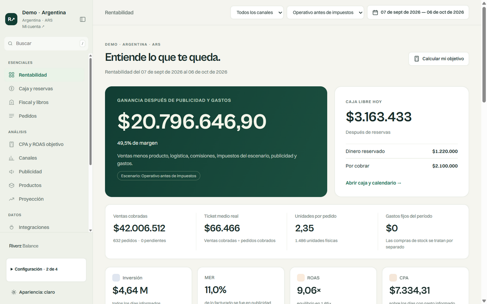
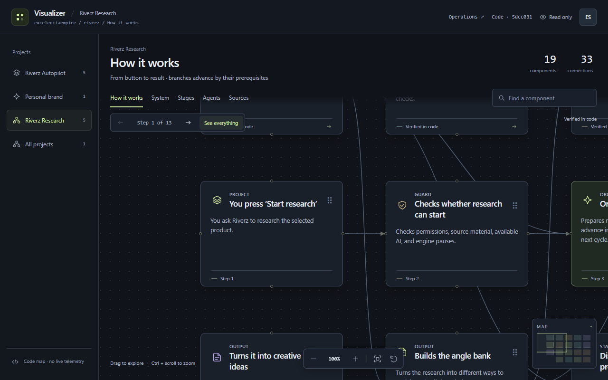

# Web and commerce projects

These projects cover business applications, a client website, storefront customization and interface work. The summaries expose no operational accounts or business records.

## Riverz Balance and Saldexo

**Work:** The earlier Saldexo/Shopify accounting application synchronizes orders, computes business figures, tracks transfers/expenses and optionally updates a spreadsheet. The same development repository also contains its newer **Riverz Balance** application.

**My contribution:** Evolving the financial model into a multi-business workspace with country/currency-specific settings, profitability and cash views, receipts, ledger entries and business-scoped integrations. This includes separate synchronization and reconciliation workflows, rather than treating every connector as one identical source.

**Stack and status:** Python, JavaScript/HTML/CSS, PostgreSQL/Supabase and Clerk; the earlier application uses SQLite. Implementation and deployment notes exist, but official electronic tax issuance/filing is explicitly disconnected pending the required providers and taxpayer authorization. Private business amounts and credentials are not published.

### Riverz Balance profitability

Actual application with Demo · Argentina data, October 6, 2026; native Spanish/light interface. All financial figures are demonstration values.

[Capture provenance](../SCREENSHOTS.md)

## Nicolas Vehiculos

**Work:** A mobile-oriented automotive lead-qualification website. A guided questionnaire gathers vehicle preference, budget, down payment, timing and financing context.

**My contribution:** Page layout, the multi-step interaction and buyer-facing content, using HTML, CSS and JavaScript.

**Stack and status:** A static client-website implementation with local assets. The repository establishes the website work; it does not establish financing approval, a completed lender integration or a conversion result.

## Blackyak

**Work:** Tiendanube storefront customization, including brand navigation, product-content templates, supporting pages, commerce components and styling.

**My contribution:** Brand-specific templates and interface changes within an existing storefront/theming platform. This is storefront and frontend work, not authorship of Tiendanube or an ecommerce platform built from scratch.

**Stack and status:** Storefront templates, HTML, CSS and JavaScript. The private repository contains layouts, snippets, settings and assets. This case presents those changes without publishing store configuration or claiming a newly verified production checkout.

## Riverz company website

**Work:** A bilingual Spanish/English company site and project portfolio, with static project pages, original application captures and an interactive Three.js visual.

**My contribution:** Content modeling, the page generator, responsive interface, navigation and accessible screenshot interactions, with reduced-motion behavior.

**Stack and status:** HTML, CSS, JavaScript and Three.js. The implementation is a separate company-site project; its privacy and hosting settings are not changed by this GitHub portfolio.

## Visualizador

**Work:** A bilingual, read-only canvas for explaining application architecture and workflows. It includes draggable cards, pan/zoom, search, a minimap, source references and guided journeys.

**My contribution:** Graph data/models, project/view navigation, interaction state, keyboard support and a read-only Content Studio overview with a dated offline snapshot.

**Stack and status:** JavaScript, a web canvas/interface and local read-only integration. The maps distinguish available capabilities from proposed orchestration; navigating the diagram does not execute agents or enable merchant automation.

### Visualizador architecture canvas

Archived implemented application, October 7, 2026; English/dark interface. The canvas explains architecture; it does not show live task execution.

[Capture provenance](../SCREENSHOTS.md)

[Full portfolio](../README.md)
